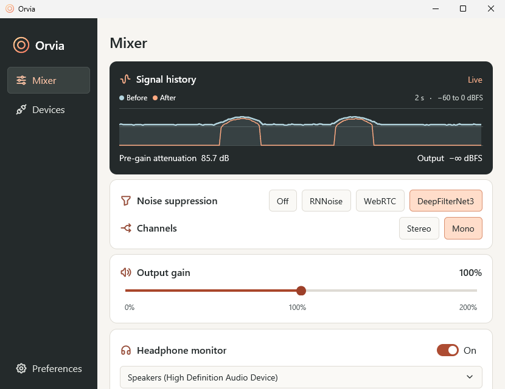

# 

Give your game or recorder a cleaner microphone while your voice chat keeps the original. Orvia removes background noise on your own CPU. Listen through headphones, watch the before-and-after signal, and adjust the gain while you speak.

## Hear the difference

The same voice competes with typing and with an air conditioner. Listen for key taps in the pauses and for consonants while the speaker talks. **[Download the listening comparison](docs/samples/listen.html?raw=true)** and open it in your browser to switch filters at the same point in either recording. The individual clips below use the same gain.

| Filter | Keyboard typing | Air conditioner |
| --- | --- | --- |
| Off | [Original recording](docs/samples/keyboard-original.flac?raw=true) | [Original recording](docs/samples/air-conditioner-original.flac?raw=true) |
| RNNoise | [Listen · 39.9 dB](docs/samples/keyboard-rnnoise.flac?raw=true) | [Listen · 54.8 dB](docs/samples/air-conditioner-rnnoise.flac?raw=true) |
| WebRTC | [Listen · 23.1 dB](docs/samples/keyboard-webrtc.flac?raw=true) | [Listen · 17.7 dB](docs/samples/air-conditioner-webrtc.flac?raw=true) |
| DeepFilterNet3 | [Listen · 28.2 dB](docs/samples/keyboard-deepfilternet3.flac?raw=true) | [Listen · 40.6 dB](docs/samples/air-conditioner-deepfilternet3.flac?raw=true) |

The dB values measure background reduction in the second before speech. On these two recordings, RNNoise removed the most noise during the pause. DeepFilterNet3 scored highest for speech intelligibility. [Audio credits and measurements](docs/samples/CREDITS.md)

## Get started

| System | Install | Microphone for your game or recorder |
| --- | --- | --- |
| Windows 11 x64 | Install the [MSI](https://github.com/sya-ri/orvia/actions/workflows/windows.yml) and a supported virtual cable. Secure Boot can stay on. | The recording side of [Virtual Audio Cable](https://vac.muzychenko.net/en/download.htm) or an Elgato Wave Link mix |
| macOS 13+ | Open the [DMG for your Mac](https://github.com/sya-ri/orvia/actions/workflows/desktop.yml), drag Orvia to Applications and install [BlackHole 2ch](https://github.com/ExistentialAudio/BlackHole). Allow microphone access when prompted. | BlackHole 2ch |
| Ubuntu 24.04 x64 with PipeWire | Install the [DEB](https://github.com/sya-ri/orvia/actions/workflows/desktop.yml) and sign out and back in to load its virtual microphone. | Orvia Microphone |

In **Devices**, select your physical microphone and the matching virtual output. Choose a filter in **Mixer**. In apps that should hear the original, keep the physical microphone selected.

[Build and verify](docs/testing.md) · [Contributing](CONTRIBUTING.md) · [MIT license](LICENSE)
